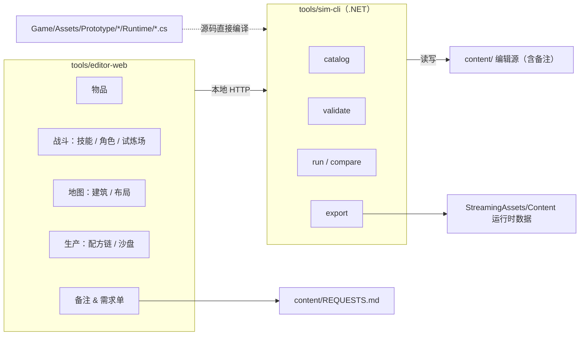

# Helper 编辑器设计规划

日期：2026-11-15。作者：辅助架构 / 编辑器前端设计。执行由各专项 Agent 负责，本文件是施工依据和验收标准。界面线框见同目录 [editor-plan-wireframes.html](editor-plan-wireframes.html)（用浏览器打开；其中的 mermaid 图在普通浏览器里显示为源码，结构图以本文为准）。

本文件只规划开发辅助工具，不改写 [PROJECT_CONTEXT.md](../context/PROJECT_CONTEXT.md) 里已确认的玩法规则。

## 已定决策（User 2026-11-15 确认）

| # | 决策 | 结论 |
| --- | --- | --- |
| 1 | 编辑器形态 | 本地网页编辑器 `tools/editor-web` + 无头 C# 模拟器 `tools/sim-cli`。规则只由 sim-cli 直接编译现有 `Runtime/*.cs` 执行，编辑器不重写规则。不进游戏包，不改 Unity 场景 / Prefab。 |
| 2 | “角色 json” | 角色模板、技能库与战例分开。编辑器产出角色模板和技能；组装器拼出现有 `CombatScenario` 格式，运行时行为与旧 DTO 不改。P2 唯一源码例外是工单指定的联场只读原会话日志观察接口，不扩展战斗规则。 |
| 3 | 居民行为 | 策划按职业写“行为档案”（沿用战斗四段指令句式）；玩家在游戏内只调税、福利、岗位优先级等政策，不逐个编辑居民。 |

## 现状与缺口

| 领域 | 现有可用 | 缺口 |
| --- | --- | --- |
| 技能 | `CombatActionConfig` 13 字段，27 个法师技能可执行 | 技能挂在每份战例的 `actions[]`，没有全局技能库；咏唱、暴击闪避、DoT、复活、移动未实现 |
| 角色 | `CombatUnitConfig`：HP/MP、智力、敏捷系数、指令、白名单、tags | 六维中只有智力进入战斗；力量、体质、精神、集中无映射公式 |
| 指令 | 四段指令、1–3 项条件、AND/OR 分组、按智力算容量，编辑 API 返回 `validationReason` | 无 |
| 物品 | 掉落 `itemId+quantity`；强化消耗矿料 3 + 淬火砂 2 | 没有物品定义表；装备对战斗只有 `equipmentDamageBonus` |
| 建筑 / 地图 | 10×5 格子图、预置厨房、按格计 tick 移动 | 没有建筑定义和摆放；寻路固定先 x 后 y，不支持障碍 |
| 生产 / 居民 | “购粮 → 加工 → 售餐”单链，账本守恒、可重放 | 没有通用配方、居民需求和决策模型 |

## 总体架构



已验证的前提（2026-11-15，macOS，.NET SDK 10.0.403，目标 net8.0）：Combat / Tactics / BaseEconomy / Expedition 四个 Runtime 目录脱离 Unity 一起编译，0 警告；`System.Text.Json`（IncludeFields）能读入全部 19 份战斗 / 出征配置并跑完。逐文件结果见 [P0_WORK_ORDER.md](P0_WORK_ORDER.md)。

### 目录约定

```
content/                    编辑源，Git 管理，一实体一文件
  items/  skills/  characters/  encounters/
  buildings/  recipes/  layouts/
  _requests/REQ-0001.json   备注与需求单
  REQUESTS.md               sim-cli 生成，按专项分组
Game/Assets/StreamingAssets/Content/
                            sim-cli export 生成（P1 起），去掉备注与草稿
tools/sim-cli/              无头模拟器
tools/editor-web/           网页编辑器（P1 起）
```

### 格式硬规则

- Unity `JsonUtility` 不支持字典、顶层数组、多态：schema 只用对象和对象数组，键值对写成 `[{ "id": ..., "value": ... }]`。
- 每个文件带 `schemaVersion`。sim-cli 读入后按 JsonUtility 语义补默认值（字符串空 → `""`、数组空 → `[]`、可序列化对象空 → 新实例），保证与 Unity 加载结果一致。
- 编辑源与运行时数据分开：备注、草稿、需求单只存在于 `content/`；export 校验不过不出数据。

### 全局 ID 规则

| 规则 | 做法 |
| --- | --- |
| 格式 | `^[a-z][a-z0-9_]*$`，新建实体带类型前缀：物品 `mat_ eq_ con_ cur_ key_`，角色 `chr_`，建筑 `bld_`，配方 `rcp_`，遭遇 `enc_`。符合格式的旧 ID（如 `mage_*`、`expedition_ore`）原样保留、不加前缀；带连字符的旧写法（如 `expedition-ore`、`quenching-sand`）记入 `aliases`。 |
| 唯一 | 所有 `id` 与 `aliases` 合在一起全内容库唯一，不只在类型内唯一。 |
| 不可变 | 首次保存后锁定；改名只改显示名。改 ID 走“迁移”：改写全部引用并在 `aliases` 留旧 ID。 |
| 删除 | 被引用时禁止删除，列出引用处。 |
| 定义与实例 | 物品表只存定义（巡卫短剑）；带强化等级和归属的个体（`guard-linen-sword-001`）是运行时状态，不进编辑器。 |

### 备注与需求单

三个编辑器共用。任何实体、任何字段都可挂备注；`kind=note` 是纯备注，其他 kind 是要 Agent 实现的需求。

```json
{
  "schemaVersion": 1,
  "id": "REQ-0007",
  "kind": "new_effect",
  "owner": "combat",
  "target": "skill:mage_chant_meteor",
  "field": "effectKind",
  "title": "咏唱型技能：读条 60 WAIT 后落地",
  "body": "咏唱期间被打断则不消耗 MP。",
  "expected": "对全体敌人 40 魔法伤害",
  "status": "open",
  "createdAt": "2026-11-15",
  "resolvedBy": ""
}
```

- `kind`：`note` `new_effect` `new_condition` `new_selector` `new_status` `new_building_function` `new_item_property` `balance` `bug`。
- `status`：`open` → `triaged` → `in_progress` → `done` / `rejected`。只有总策划或 User 能改为 `triaged`；Agent 完成后改 `done` 并在 `resolvedBy` 填提交号。
- 占位实体：选了目录里没有的效果、条件或建筑功能，实体标“待实现”（`draft: true`），必须附一条需求才能保存；它进不了试跑和 export。
- `content/REQUESTS.md` 由 `sim-cli requests` 生成并提交到仓库，Agent 只读这一个文件；总策划负责分拣。

## 战斗编辑器（P2）

三块：技能库、角色模板、试炼场。

- 四段指令读成一句中文：“当 [条件] 对 [范围] 按 [选择方式] → [技能]”。四格均为下拉，选项来自 `sim-cli catalog`，按 `category` 分组，悬停显示 C# 的 `description`。
- 阈值按 `thresholdUnit` 显示：ratio 显示百分比、存 0–1；row 显示前 / 中 / 后排；其余显示原单位。整数项禁止小数。
- 每个条件项有“自身 / 目标”切换（`subject`）。条件项为 2 时出现且 / 或，为 3 时出现括号位置切换（`grouping` left / right），直接画括号。
- 改动防抖 300 ms 调 `validate`，用 C# 返回的 `validationReason` 标注；编辑器不自己算容量。超容量指令置灰。
- 技能下拉只列白名单技能；MP 不足不隐藏（与 `GetAvailableActions` 一致）。
- 试炼场：对手来自 `content/encounters/`，敌人也是角色模板；“与上次保存对比”给出第一处行动分歧；日志用 `ExportLogText` 原文，每行可跳回触发指令；时间轴按 WAIT 画、每角色一条泳道；支持连续场次（`CombatExpeditionConfig`）。
- 技能表单字段随 `effectKind` 切换，右侧一句话读出配置（“消耗 8 MP，占用 40 WAIT，对 1 名目标造成 28 点魔法伤害”）。“其他（未实现）”效果强制附需求。

角色模板格式：

```json
{
  "schemaVersion": 1,
  "id": "chr_mage_apprentice",
  "name": "见习法师",
  "role": "combat",
  "tags": ["mage", "caster"],
  "attributes": [
    {"id": "strength", "value": 6}, {"id": "constitution", "value": 9},
    {"id": "intelligence", "value": 40}, {"id": "spirit", "value": 18},
    {"id": "agility", "value": 10}, {"id": "focus", "value": 12}
  ],
  "combatOverride": {"maxHp": 100, "maxMp": 30, "agilityFactor": 1.0},
  "availableActionIds": ["mage_firebolt"],
  "instructions": [],
  "defaultEquipment": [{"slot": "weapon", "itemId": "eq_training_staff"}],
  "draft": false
}
```

`combatOverride` 是过渡字段：六维映射公式进入 C# 之前手填，之后由 sim-cli 计算派生值并标出不一致。导出两种：角色 JSON（上面这份）和“导出为战例”（组装为 `CombatScenario`，`availableActionIdsExplicit` 固定 true）。

## 物品编辑器（P1）

表格为主，右侧详情抽屉。关键列“来源 / 用途”（反查掉落、配方、强化、造价），无来源标黄。支持从 Excel 粘贴批量建。

```json
{
  "schemaVersion": 1,
  "id": "eq_patrol_sword",
  "name": "巡卫短剑",
  "category": "equipment",
  "stackLimit": 1,
  "baseValue": 40,
  "tags": ["weapon", "public_issue"],
  "equipment": {
    "slot": "weapon",
    "combatBonus": [{"id": "equipmentDamageBonus", "value": 0}],
    "enhancement": [
      {"level": 1, "cash": 0, "attackBonusDelta": 4,
       "materials": [{"itemId": "expedition-ore", "quantity": 3},
                     {"itemId": "quenching-sand", "quantity": 2}]}
    ]
  },
  "draft": false
}
```

- `category`：`material` `equipment` `consumable` `currency` `key`，各自挂扩展块；切换类型清空其他块并提示。
- `combatBonus` 可选项来自 sim-cli 的“已接通战斗字段”，目前只有 `equipmentDamageBonus`；其他属性走需求单。

## 地图编辑器（P3）

两层：建筑定义、布局。布局画布提供“通行距离”叠加层（从选中建筑入口按实际寻路计格数和 tick），因为现有基地模拟中摆放直接决定耗时（首餐近厨房 tick 7，远厨房 tick 17）。

```json
{
  "schemaVersion": 1,
  "id": "bld_kitchen",
  "name": "厨房",
  "footprint": {"w": 2, "h": 2},
  "entrance": {"x": 1, "y": 2},
  "function": "workshop",
  "recipeIds": ["rcp_simple_meal"],
  "workSlots": 1,
  "storageSlots": 4,
  "ownership": "both",
  "buildCost": {"cash": 30, "workTicks": 40,
    "materials": [{"itemId": "mat_timber", "quantity": 6}]},
  "draft": false
}
```

- `function`：`workshop` `storage` `housing` `shop` `public_service` `decoration`；除厨房这一例外均无运行时，可建但标“待实现”。
- 布局文件：地图尺寸、地形格、建筑实例（`instanceId buildingId x y rotation ownership`）、居民出生点。
- 校验：越界、重叠、入口被堵、不可达（与模拟器同一套寻路）。
- 建筑只引用配方 ID，配方在生产页配置。

## 生产线验证与居民行为（P3 / P4）

| 层 | 回答 | 做法 | 前置 |
| --- | --- | --- | --- |
| 1 静态链检查 | 数据上通不通、赚不赚钱 | 配方成图：缺来源输入、死胡同、循环；单位工时增值 =（产出参考价 − 投入参考价）÷ 工时，≤ 0 的私营环节没人做 | 物品 + 配方，P3 |
| 2 账本推演 | 跑 N 天会不会断粮、钱去哪、谁闲着 | sim-cli 固定种子跑通用基地模拟：账本、库存曲线、居民时间分配、现金守恒、瓶颈报告 | 基地专项通用模拟，P4 |
| 3 沙盘回放 | 哪里堵、哪里绕路 | 在布局画布回放第 2 层结果，时间轴可拖 | 第 2 层 |

居民行为档案沿用“按优先级逐条尝试”的规则列表，复用战斗指令行组件。基地专项需先写《居民决策模型 v0》（条件 / 对象 / 选择方式 / 行动四个目录，形式参照 `CombatTacticsCatalog`），并回答四个与战斗不同的问题：需求与时段、长动作能否打断、多人抢同一资源的预约、定价等经济决策的参数化。

## 分期与验收

施工单：[P0](P0_WORK_ORDER.md) · [P1](P1_WORK_ORDER.md) · [P2](P2_WORK_ORDER.md) · [P3](P3_WORK_ORDER.md)。P4 等基地专项交付 R5 后再写。P2、P3 写于 P0 交付前，开工前按 P0 实际接口复核。

| 期 | 内容 | 负责 | 验收要点 |
| --- | --- | --- | --- |
| P0 | sim-cli、content 骨架、需求单 | 工程；战斗专项补一个公开对比方法 | 见 [P0_WORK_ORDER.md](P0_WORK_ORDER.md) |
| P1 | 编辑器外壳 + 物品编辑器 + export | 前端 Agent + 工程 | 录入现有 5 种物品，旧连字符 ID 作为 alias 解析到同一物品；强化表复现“矿料 3 + 淬火砂 2 → 攻击 +4”；ID 锁定、重复拒绝、被引用不可删；粘贴 10 行批量建冲突行单独标出；1280×800 与 1920×1080 截图无横向溢出 |
| P2 | 战斗编辑器 | 前端 + 工程（组装器、遭遇格式） | 重建 `round4_mage_library` 后导出战例运行结果一致；交换两条指令后显示的第一处分歧与 `CombatSampleRuns` 一致；智力 40 → 10 时提示与 C# `validationReason` 完全相同；“未实现”技能进不了试跑但出现在 `REQUESTS.md` |
| P3 | 地图 + 配方 + 静态链 | 前端；基地专项改寻路支持障碍 | 重建首餐布局，距离叠加推出 tick 7 / 17；重叠、越界、入口被堵、不可达各一例全部拦截；无来源材料被报出，配方显示单位工时增值 |
| P4 | 基地沙盘 + 行为档案 | 待定 | 等《居民决策模型 v0》后再写 |

前端技术栈：React + TypeScript + Vite，Tailwind + shadcn/ui，图标 Lucide，状态 Zustand，指令拖拽 dnd-kit。

## 需要其他专项补的

详细需求说明见 [SPECIALIST_REQUESTS.md](SPECIALIST_REQUESTS.md)（R1–R6）。

| 需求 | 归属 | 影响 |
| --- | --- | --- |
| 六维 → maxHp / maxMp / 敏捷系数 / 伤害映射公式 | 战斗专项 | 不卡；P2 先手填 `combatOverride` |
| 技能从战例 `actions[]` 抽成全局库，战例只引用 ID | 战斗 + 工程 | 不卡；组装器先过渡 |
| 物品定义 / 实例分离；装备除伤害加值外的属性如何进入战斗 | 工程 + 战斗 | P1 只做定义 |
| 寻路支持障碍格 | 基地专项 | P3 可达性检查 |
| 通用基地模拟（建筑、配方、居民需求、交易预约） | 基地专项 | P4 |
| `content/`、`tools/` 的文件负责人 | 总策划 | P0 默认工程负责，可调整 |
